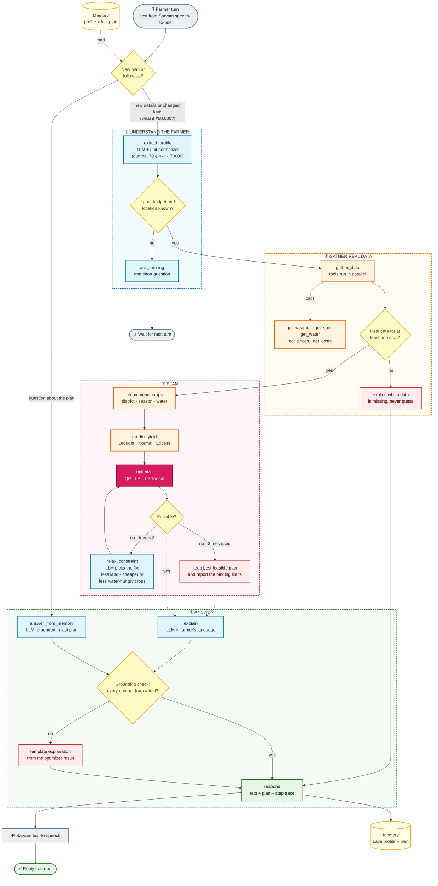

# The_King
## FORGE_26 Hackathon: AgriPulse, an AI-Based Crop and Agricultural Resource Optimization System

---

## Team Name & Details
* **Team Name:** The_King
* **Team Leader Name:** Pavan Kumar
* **Team Members:** Shanmukh, Srivardhan
* **Team Leader Mobile Number:** 9849820952
* **Team Leader Email:** iec2025049@iiita.ac.in
* **College Name:** IIIT Allahabad

---

## Domain and Problem Statement
* **Domain:** Agritech, Climate Resilience & Rural Economics
* **Theme:** Climate, Resource Infrastructure & Global Supply Resilience
* **The Problem (The Reality of Indian Farming):**
  * **Data is Highly Scattered:** Weather, soil health, groundwater levels, reservoir storage, mandi prices and cultivation costs sit on different government portals. No farmer can combine them to make one decision.
  * **Advice Stops at "Grow X":** Existing tools recommend a crop, but don't answer the real question: *"How do I split my 5 acres and ₹70,000 across crops, with the water I actually have?"*
  * **Plans Ignore Bad Years:** A plan that is best in an average year can lose money in a drought, and droughts are frequent in regions like Marathwada and Vidarbha. Over-use of groundwater and fertilizer makes it worse every year.
  * **The Usability Barrier:** Most agricultural AI tools are built for engineers. They expect values like "Soil Nitrogen (kg/ha)" typed in English, which rural farmers cannot provide.
* **Our Goal:** A voice-first AI agent that plans a farm season **with** the farmer, using only live and official data, and produces a plan that stays profitable even in a drought while saving water and fertilizer.

---

## Idea / Solution
* **The Core Idea:** AgriPulse, an AI agent that talks to the farmer in their own language and turns scattered government data into a climate-resilient crop, land, water, fertilizer and budget plan.
* **How it Solves the Problem:**
  * **1. Just Talk:** The farmer speaks in Marathi, Hindi or English (e.g. *"I have 5 acres near Beed, ₹70,000 and a borewell"*). **Sarvam AI speech-to-text** turns the voice into text, and the agent understands the farm details and asks a short follow-up question if something is missing. No forms, no technical inputs.
  * **2. Centralized Live Data:** The agent automatically fetches weather (forecast + 15 years of history), Soil Health Card nutrients, groundwater status, reservoir storage, live mandi prices and official cultivation costs for that district.
  * **3. Climate-Resilient Optimization:** A Quadratic Programming optimizer splits land, water, fertilizer and budget across suitable crops, and tests the plan against **Normal, Drought and Excess-rain** years.
  * **4. Explained in the Farmer's Language:** The agent explains the plan as text, and **Sarvam AI text-to-speech** reads it aloud. It answers follow-up questions (*"What if I only have ₹50,000?"*) and shows every step it took.

---

## Existing Vs Proposed System
* **Existing Systems:**
  * Disconnected apps (one for weather, one for mandi prices, one for soil cards).
  * Inputs are technical and in English.
  * Outputs are a single crop name (classification only), with no budget, water or fertilizer planning.
  * Plans assume an average year and ignore groundwater limits.
* **Our Proposed System:**
  * **Unified, Live Ecosystem:** Weather, soil, groundwater, reservoirs, prices and costs are retrieved automatically from official sources, and every number shows its source and date.
  * **Agentic AI:** A LangGraph agent that calls tools, fixes plans that cannot work, and remembers the farm for follow-up questions.
  * **Operations Research + ML:** We don't just predict; we optimize with Quadratic Programming across climate scenarios, under real water limits.
  * **Vernacular Voice UI:** Speech in, speech out, in Marathi, Hindi and English.

---

## Innovation & USP (Unique Selling Proposition)
*(Our innovations span across Agentic AI, Optimization, Data and UX)*

* **🤖 Agentic AI with Live Reasoning**
  * A *LangGraph* agent extracts the farm profile from speech, calls data and model tools, checks whether the plan is feasible, and **corrects itself** (e.g. moves land to less water-hungry crops when the water limit is broken).
  * A **live step trace** shows the farmer and judges every tool call, data source and time taken.
  * **Memory** of the farm and the last plan allows natural follow-up questions.
  * A **grounding check** makes sure every number in the AI's answer comes from real tool outputs.
* **🔍 Explainable Crop Suitability from Real Data**
  * No synthetic dataset: crops are filtered using official records (grown in the district, sowable now, within the water limit), then scored by our own yield model trained on 15+ years of real district yields.
  * SHAP values on that model show *why* a crop suits this season (e.g. "rainfall above normal: +0.3 t/ha, long dry spell: −0.2 t/ha"), and the agent explains it in the farmer's language.
* **🌦️ Climate-Scenario Quadratic Programming**
  * Drought, Normal and Excess-rain scenarios are built from 15+ years of district weather history (ERA5).
  * The QP objective balances **expected profit**, **risk** (profit variation across years and price history), the **fertilizer response curve** (*yield = a + b·f − c·f²*) and **market saturation**.
  * Four strategies are compared side by side: **Traditional crop mix**, **LP max-profit**, **QP balanced** and **QP drought-safe**.
* **💧 Real Water Accounting**
  * Available water = rainfall (recent + forecast + scenario) + groundwater share (capped by the official CGWB block category) + canal share (reservoir storage).
  * Crop water need = *Kc × ET₀ − effective rainfall* (FAO-56), adjusted for flood, sprinkler or drip efficiency.
* **📊 Strictly Live & Official Data**
  * No mock or hardcoded values anywhere. If a live API fails, the last real response is used and labelled *"cached, as of <date>"*. If real data does not exist, the crop is left out and the reason is shown.
  * One canonical list of 36 Maharashtra districts with all spelling variants (e.g. Aurangabad → Chhatrapati Sambhajinagar), so every dataset joins correctly.
* **🎙️ Zero-Friction Farmer UX**
  * Voice-first, mobile-first, with local-language labels and numbers in acres, quintals and rupees.
  * **Sarvam AI** (built for Indian languages) powers both voice input (speech-to-text) and voice output (text-to-speech) in Marathi, Hindi and English.
* **🧠 Multi-Provider LLM Agent**
  * The agent runs on **Gemini** and **Groq** models, with automatic fallback from one to the other if a provider is slow or rate-limited. Sarvam's language models are being evaluated as an agent option for better Marathi and Hindi understanding.
* **📐 Indian Agricultural Unit Conversions**
  * Government data in hectares and tonnes is converted into farmer units (**acres and quintals**) throughout.

---

## Objective & Scope of Solution
* **Key Objectives:**
  * Make data-driven farm planning usable by any farmer through voice and simple visual dashboards.
  * Maximize farmer profit while keeping groundwater and fertilizer use within safe limits.
  * Protect farmers in bad climate years by recommending plans that remain profitable in a drought.
* **Scope:**
  * **Pilot state: Maharashtra (36 districts).** The state is a configuration setting; any state with the same official datasets can be added.
  * Crops grown in Maharashtra and sowable in the current season, including soybean, cotton, tur, jowar, wheat, sugarcane, onion and pulses.
  * Languages: Marathi, Hindi and English.
  * Planning for one farm and one season, with climate scenarios for that season.

---

## System Architecture (Logical Data Flow)
*(The farmer talks to the agent; the agent calls live data, model and optimizer tools, fixes plans that cannot work, and explains the result in the farmer's language.)*

### 1. Layered architecture

*(Click the image to open it full size. Editable vector source: [`docs/architecture.svg`](docs/architecture.svg).)*

| # | Layer | What it does |
| :---: | :--- | :--- |
| 1 | **Data Sources** | Live APIs and official datasets only: weather, soil, water, mandi prices, costs and yields. No mock data |
| 2 | **Data Ingestion** | Secure API connection, parallel async fetching, validation, and a cache that keeps the source and date of every value |
| 3 | **Data Processing & Feature Engineering** | Cleaning, season-aligned weather features, leak-free time-based split, processed datasets |
| 4 | **ML & Science** | Crop filters from official data, yield model with a yield-based suitability score and SHAP explanations, Drought / Normal / Excess climate scenarios, crop water need and fertilizer response curves |
| 5 | **Agent System** | LangGraph agent: extracts the farm profile, calls tools, runs the QP / LP optimizer, corrects infeasible plans and explains the result |
| 6 | **User Interface** | Voice-first React app with Sarvam speech in and out, live agent trace, source badges and a FastAPI backend |
| 7 | **Storage, Monitoring & Feedback** | Data store and real-response cache, latency and API-health monitoring, follow-up and retraining loop |

### 2. System architecture (modules and how they connect)

Which modules exist and what each one talks to.

```mermaid
flowchart TB
    classDef fe fill:#FFF3E0,stroke:#EF6C00,stroke-width:2px,color:#4E2600
    classDef api fill:#E3F2FD,stroke:#1565C0,stroke-width:2px,color:#0D2B52
    classDef agent fill:#E8F5E9,stroke:#2E7D32,stroke-width:2px,color:#0B3D0B
    classDef svc fill:#E0F7FA,stroke:#00838F,stroke-width:2px,color:#004D55
    classDef ml fill:#F3E5F5,stroke:#8E24AA,stroke-width:2px,color:#38006B
    classDef opt fill:#D81B60,stroke:#880E4F,stroke-width:2px,color:#FFFFFF
    classDef store fill:#FFFDE7,stroke:#F9A825,stroke-width:2px,color:#5D4300
    classDef ext fill:#ECEFF1,stroke:#607D8B,stroke-width:2px,color:#263238

    subgraph FE["🖥️ FRONTEND · React + Vite + Tailwind"]
        direction LR
        CHAT["Voice + chat input"]
        PROF["Farm profile card"]
        DASH["Plan dashboard<br/>scenarios · strategies · water gauge"]
        TRACE["Agent trace +<br/>source badges"]
    end

    subgraph API["🔌 BACKEND API · FastAPI"]
        direction LR
        R1["/api/agent/chat<br/>(SSE stream)"]
        R2["/api/plan"]
        R3["/api/transcribe<br/>/api/speak"]
        R4["/api/prefetch<br/>/api/sources/health"]
    end

    subgraph AG["🤖 AGENT · LangGraph"]
        direction LR
        GRAPH["Graph nodes +<br/>conditional edges"]
        TOOLS["Tools"]
        MEM[("Memory<br/>SQLite checkpointer")]
        ROUTER["LLM router<br/>Gemini · Groq · Sarvam"]
    end

    subgraph SV["🌐 DATA SERVICES"]
        direction LR
        LOC["Location"]
        WX["Weather"]
        SOIL["Soil"]
        WAT["Water budget"]
        PRI["Prices"]
        COST["Costs"]
    end

    subgraph MLM["🧠 ML & SCIENCE"]
        direction LR
        SUIT["Crop<br/>suitability"]
        YLD["Yield<br/>model"]
        SCN["Climate<br/>scenarios"]
        FERT["Fertilizer<br/>curve"]
    end

    subgraph OPTM["⚙️ OPTIMIZER"]
        direction LR
        QP["QP<br/>risk-aware"]
        LP["LP<br/>baseline"]
        TRAD["Traditional<br/>plan"]
    end

    subgraph DATA["🗄️ DATA LAYER"]
        direction LR
        FILES[("Official datasets<br/>data/processed")]
        CACHE[("Real-response cache<br/>SQLite")]
    end

    subgraph EXT["☁️ EXTERNAL SERVICES"]
        direction LR
        SARVAM["Sarvam AI<br/>speech"]
        LLMS["Gemini · Groq<br/>LLMs"]
        OM["Open-Meteo"]
        GOV["data.gov.in<br/>Agmarknet · CWC"]
        SG["SoilGrids"]
    end

    FE <-->|"REST + SSE"| API
    API -->|"run agent turn"| AG
    API -->|"prefetch"| SV
    API <-->|"audio and text"| EXT
    AG -->|"tool calls"| SV
    AG -->|"tool calls"| MLM
    AG -->|"tool calls"| OPTM
    AG <-->|"LLM calls"| EXT
    SV -->|"fetch live data"| EXT
    SV <-->|"read and write"| DATA
    MLM -->|"training data, lookups"| DATA
    MLM -->|"yields, water need, scenarios"| OPTM
    SV -->|"prices, costs, water limit"| OPTM

    class CHAT,PROF,DASH,TRACE fe
    class R1,R2,R3,R4 api
    class GRAPH,TOOLS,MEM,ROUTER agent
    class LOC,WX,SOIL,WAT,PRI,COST svc
    class SUIT,YLD,SCN,FERT ml
    class QP,LP,TRAD opt
    class FILES,CACHE store
    class SARVAM,LLMS,OM,GOV,SG ext

    style FE fill:#FFFAF2,stroke:#EF6C00,stroke-width:2px,stroke-dasharray: 5 3
    style API fill:#F3F8FE,stroke:#1565C0,stroke-width:2px,stroke-dasharray: 5 3
    style AG fill:#F4FAF4,stroke:#2E7D32,stroke-width:2px,stroke-dasharray: 5 3
    style SV fill:#F1FBFC,stroke:#00838F,stroke-width:2px,stroke-dasharray: 5 3
    style MLM fill:#FAF4FB,stroke:#8E24AA,stroke-width:2px,stroke-dasharray: 5 3
    style OPTM fill:#FEF5F8,stroke:#D81B60,stroke-width:2px,stroke-dasharray: 5 3
    style DATA fill:#FFFEF3,stroke:#F9A825,stroke-width:2px,stroke-dasharray: 5 3
    style EXT fill:#F7F9FA,stroke:#607D8B,stroke-width:2px,stroke-dasharray: 5 3
```

### 3. Data flow diagram

How data moves between APIs, datasets, models, the optimizer and the agent: prepared offline, then used live for each farmer request.

```mermaid
flowchart LR
    classDef store fill:#FFFDE7,stroke:#F9A825,stroke-width:2px,color:#5D4300
    classDef live fill:#E3F2FD,stroke:#1565C0,stroke-width:2px,color:#0D2B52
    classDef proc fill:#E8F5E9,stroke:#2E7D32,stroke-width:2px,color:#0B3D0B
    classDef ml fill:#F3E5F5,stroke:#8E24AA,stroke-width:2px,color:#38006B
    classDef opt fill:#D81B60,stroke:#880E4F,stroke-width:2px,color:#FFFFFF
    classDef io fill:#FFF3E0,stroke:#EF6C00,stroke-width:2px,color:#4E2600
    classDef voice fill:#EDE7F6,stroke:#5E35B1,stroke-width:2px,color:#27135C

    subgraph OFF["🛠️ OFFLINE PREPARATION · before the demo"]
        direction LR
        RAW[("Official downloads<br/>data/raw")]
        PROC[("Cleaned datasets<br/>data/processed")]
        TRAIN["Train and validate<br/>time-based split"]
        ART[("Model files<br/>yield · crop · scenario tables")]
        RAW -->|"clean + join<br/>by district"| PROC
        PROC -->|"features + target"| TRAIN
        TRAIN -->|"save"| ART
    end

    subgraph LIVE["🌐 LIVE APIs"]
        direction TB
        OM["Open-Meteo<br/>forecast · ET₀ · history"]
        GOV["data.gov.in<br/>mandi prices · reservoirs"]
        SG["SoilGrids<br/>pH · texture"]
    end

    subgraph ON["⚡ PER FARMER REQUEST · live"]
        direction LR
        VOICE["👨‍🌾 Farmer<br/>voice or text"]
        STT["Sarvam<br/>speech-to-text"]
        PROFILE["Farm profile<br/>location · land<br/>budget · water source"]
        FETCH["Async fetch<br/>+ validate"]
        CACHE[("Real-response cache<br/>value + source + date")]
        FEAT["Features +<br/>water budget"]
        MODELS["Crop suitability<br/>yield per scenario"]
        OPTZ["⚙️ Optimizer<br/>QP · LP · Traditional"]
        AGENT["🤖 Agent<br/>explain + check"]
        MEMORY[("Agent memory<br/>profile + last plan")]
        TTS["Sarvam<br/>text-to-speech"]
        OUT["📊 Dashboard +<br/>🔊 spoken reply"]

        VOICE -->|"audio"| STT
        STT -->|"text + language"| PROFILE
        PROFILE -->|"district + coordinates"| FETCH
        FETCH -->|"SourcedValue"| CACHE
        CACHE -->|"weather, soil, water"| FEAT
        FEAT -->|"inputs per scenario"| MODELS
        MODELS -->|"yield + water need"| OPTZ
        CACHE -->|"prices + costs"| OPTZ
        OPTZ -->|"PlanResult +<br/>binding limits"| AGENT
        AGENT -->|"explanation in the<br/>farmer's language"| TTS
        TTS --> OUT
        AGENT --> OUT
        PROFILE <-->|"save / load"| MEMORY
        AGENT -->|"save plan"| MEMORY
    end

    LIVE -->|"JSON"| FETCH
    PROC -->|"district tables:<br/>yields · costs · groundwater"| FEAT
    ART -->|"load at startup"| MODELS

    class RAW,PROC,ART,CACHE,MEMORY store
    class OM,GOV,SG live
    class FETCH,FEAT,PROFILE,TRAIN proc
    class MODELS ml
    class OPTZ opt
    class VOICE,OUT,AGENT io
    class STT,TTS voice

    style OFF fill:#FFFEF3,stroke:#F9A825,stroke-width:2px,stroke-dasharray: 5 3
    style LIVE fill:#F3F8FE,stroke:#1565C0,stroke-width:2px,stroke-dasharray: 5 3
    style ON fill:#F4FAF4,stroke:#2E7D32,stroke-width:2px,stroke-dasharray: 5 3
```

### 4. Agent workflow (LangGraph)

The graph nodes, the conditional edges (decisions), the tools and how the answer is generated. A follow-up such as *"What if I only have ₹50,000?"* goes back through `extract_profile` with the changed fact and re-runs the plan.

**LLM router:** `extract_profile`, `relax_constraint`, `explain` and `answer_from_memory` call Gemini first, then Groq, then Sarvam if a provider fails or times out. If every LLM is down, the template explanation is used, so the farmer always gets an answer.

### Recommendation and plan explanations

Each plan returned to the dashboard includes:

* **Crop suitability (real data only):**
  1. *Filter:* a crop is a candidate only if it is grown in the district (DES area data), can be sown now (crop calendar) and its water need fits the available water.
  2. *Score:* the yield model predicts each candidate's yield for this season's conditions. Suitability = predicted yield ÷ the crop's normal yield in the district; above 1 means better-than-usual conditions.
  3. *Explain:* SHAP values on the same yield model show which factors (rainfall, dry spell, heat days, soil, irrigation) raised or lowered the yield. SHAP values describe model attribution, not causation. If the model is weak for a crop, the district's historical average is used and the answer says so.
* **Yield and economics:** yield per crop for each climate scenario, converted to quintals per acre, with mandi price, itemized cultivation cost and net profit per acre. Yields above the district's historical maximum are clipped and flagged.
* **Optimizer evidence:** the allocation for each strategy, profit in each scenario, worst-case profit, water and fertilizer used, and which constraints (land, budget, water, diversification) were binding.
* **Agent explanation:** a short explanation in the farmer's language, generated only from tool outputs and checked so that every number matches the data. If no LLM is available, a template explanation built from the optimizer result is shown instead.
* **Sources:** every value carries its source, link, date and status (live, cached or official dataset).

API keys are kept only in a local `.env` file that is never committed. `.env.example` lists the key names.

---

## Detailed Resources Required
* **Machine Learning & Math:**
  * Scikit-Learn gradient boosting for yield with a time-based train/test split, SHAP (TreeExplainer) for explanations, SciPy (fertilizer response curve fitting, LP baseline), CVXPY (Quadratic Programming).
* **Agentic AI & Language:**
  * LangGraph (tool calling, checkpointed memory).
  * **Agent LLMs:** Google Gemini and Groq models (automatic fallback between them); Sarvam language models as an additional agent option where they perform well.
  * **Sarvam AI speech:** speech-to-text for the farmer's voice input and text-to-speech for the spoken reply, in Marathi, Hindi and English.
* **Data Sources (Official Datasets):**
  * *DES district-wise crop production statistics* (historical yields).
  * *DES/CACP Cost of Cultivation* (itemized costs per crop).
  * *Soil Health Card* (district N, P, K, pH).
  * *CGWB Dynamic Ground Water Resources*, *GSDA Maharashtra*, *Minor Irrigation Census*.
  * *FAO-56* crop water coefficients; state agricultural university fertilizer recommendations; *Dept. of Fertilizers* MRPs; *CACP* MSP; *Mahabeej* seed prices.
* **Live APIs & Mapping:**
  * **Open-Meteo:** geocoding, 16-day forecast with ET₀, and the ERA5 historical archive.
  * **data.gov.in (Agmarknet):** live daily mandi prices for Maharashtra.
  * **data.gov.in (CWC):** reservoir live storage.
  * **ISRIC SoilGrids:** soil pH and texture.
* **Full-Stack Technologies:**
  * **Backend:** Python, FastAPI, Pydantic, httpx (async), Server-Sent Events for the live agent trace.
  * **Frontend:** React + Vite + Tailwind CSS, Recharts, react-leaflet.
  * **Deployment:** Vercel (frontend), Hugging Face Spaces / Render (backend).

---

## True Impact & Working Prototype
* **🌍 True Impact:**
  * **Climate resilience:** farmers get plans that stay profitable in a drought year, not just an average year.
  * **Water security:** plans respect the official groundwater status of the farmer's block, steering over-exploited areas toward water-saving crops and drip irrigation.
  * **Less input waste:** fertilizer is recommended at the dose where extra fertilizer stops paying for itself.
  * **Access for everyone:** a farmer who cannot read can plan a season by talking in their own language.
  * **Trust:** every number shows where it came from, and every agent step is visible.

* **💻 Working Prototype:**
  * **Status:** under development. The live link will be added here after deployment.
  * **Build plan and progress:** [`frontend/SPECS.md`](frontend/SPECS.md) · [`backend/SPECS.md`](backend/SPECS.md) · [`ml/SPECS.md`](ml/SPECS.md)
  * **Data collection guide:** [`DATA_COLLECTION.md`](DATA_COLLECTION.md); every dataset is logged in `data/SOURCES.md`.

---

## Specs, Milestones & Team Workflow

| Part | Owner | Spec (design, features, tasks, status) |
| :--- | :--- | :--- |
| Frontend | Teammate B | [`frontend/SPECS.md`](frontend/SPECS.md): design system, screens, dashboard, features |
| Backend | Teammate A | [`backend/SPECS.md`](backend/SPECS.md): data layer, services, **API contract and endpoints** |
| ML & AI | Pavan Kumar | [`ml/SPECS.md`](ml/SPECS.md): yield model, suitability, scenarios, optimizer, LangGraph agent |

**Milestones**

| # | Milestone | Done when |
| :---: | :--- | :--- |
| M1 | Foundation | Repo, data in place, data tests green, API contract reviewed by all three |
| M2 | Plan without the agent | `POST /api/plan` returns a real-data plan with LP, QP and 3 climate scenarios, and the dashboard shows it |
| M3 | Agent end to end | Speak, agent, plan, spoken answer, with the live trace and one follow-up |
| M4 | Demo-ready | Deployed, failure drills pass, demo rehearsed, deck and video done |

**How we work**
* One branch per task, named by its ID (for example `feat/OPT.2-qp`, `feat/F4-agent-trace`). Small pull requests; nobody pushes to `main` directly.
* Every pull request is reviewed by one teammate and checked against the "Ground rules" at the top of each spec (above all: **no mock data**).
* Data changes go through a pull request that also updates `data/SOURCES.md`, and the data tests must pass.
* Update the task's status in its spec file in the same pull request that does the work.
* The API contract in `backend/SPECS.md` section 5 is the agreement between all three parts; change it only with all three agreeing.
* 15-minute daily check-in: done yesterday, doing today, blocked by.

