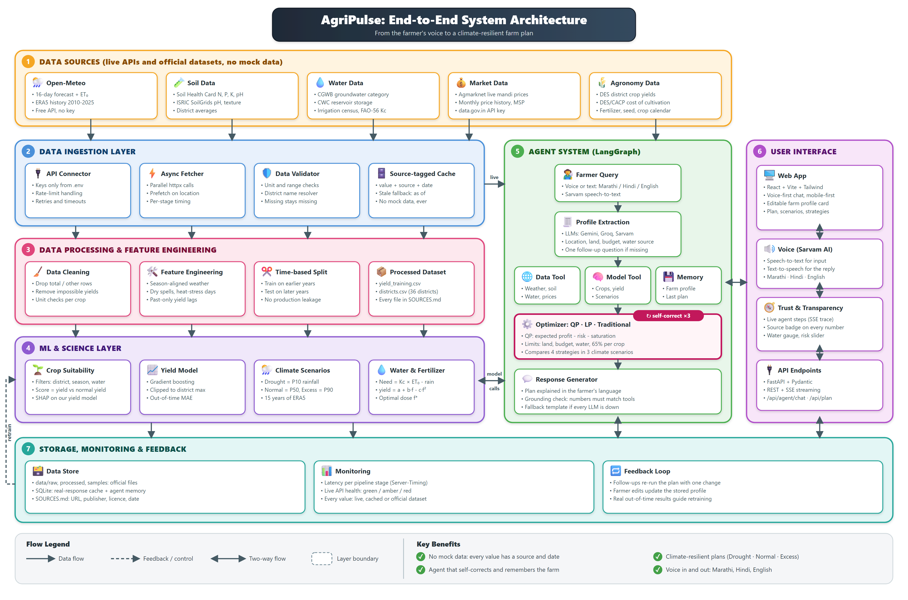

# AgriPulse

**A voice-first AI farm planner: it turns scattered government data into a crop, land, water and budget plan that a farmer can act on, and it never invents a number.**

FORGE_26 Hackathon, Theme 2: *Climate, Resource Infrastructure & Global Supply Resilience*

[](docs/architecture.png)

*Click the image to open it full size. Editable vector source: [`docs/architecture.svg`](docs/architecture.svg).*

> Note on the diagram: it shows a "QP" optimizer. In the current code the public strategies are solved with a SciPy HiGHS linear program. The CVXPY risk-aware QP is kept as an experimental, gated module and is not used for plans (see [Optimizer](#optimizer-strategies)).

---

## Contents

1. [Team](#team)
2. [Problem statement](#problem-statement)
3. [Our solution](#our-solution)
4. [Key features](#key-features)
5. [Tech stack](#tech-stack)
6. [Folder structure](#folder-structure)
7. [Data sources](#data-sources)
8. [Setup and run](#setup-and-run)
9. [Verified results](#verified-results)
10. [API endpoints](#api-endpoints)
11. [Known limitations](#known-limitations)
12. [Acknowledgements and license](#acknowledgements-and-license)

---

## Team

**Team name:** The_King  **College:** IIIT Allahabad  **Team leader:** Pavan Kumar ([iec2025049@iiita.ac.in](mailto:iec2025049@iiita.ac.in))

| Member | Role | Key contributions |
| :--- | :--- | :--- |
| **Pavan Kumar** (team leader) | **Team lead · ML & AI** | Guided the team through the frontend and backend builds. Built the ML and AI layer: yield model, crop suitability with SHAP explanations, climate scenarios, profit optimizer and the LangGraph farmer agent. |
| **Shanmukh** | **Data collection (environment & water) · Backend** | Collected the environment and water datasets: weather and ET₀ forecast, 10+ years of historical weather, SoilGrids soil properties, Soil Health Card NPK, FAO-56 crop water coefficients, district coordinates, CGWB groundwater status, recent rainfall, reservoir and canal storage, irrigation efficiency ([checklist](docs/collection/TEAMMATE_A_CHECKLIST.md)). Built parts of the backend. |
| **Srivardhan** | **Frontend design & development · Data collection (economics & agronomy)** | Designed and built the entire frontend: farm profile, dashboard, strategy comparison, sources page, chat and voice UI, Marathi/Hindi/English screens. Collected the economics and agronomy datasets: live mandi prices, price history, district crop yields, cost of cultivation, fertilizer prices and doses, MSP, crop calendar, seed rates, crop name master table, district fertilizer use, AI language tests ([checklist](docs/collection/TEAMMATE_B_CHECKLIST.md)). |

---

## Problem statement

Indian farmers have the data they need, but it is spread out and hard to use:

- **Scattered data.** Weather, soil health, groundwater, reservoir storage, mandi prices and cultivation costs sit on different government portals. No farmer can combine them into one decision.
- **Advice stops at "grow X".** Existing tools name a crop. They do not answer "how do I split my 5 acres and Rs 70,000 across crops with the water I actually have?"
- **Plans ignore bad years.** A plan that is best in an average year can lose money in a drought, which is common in regions like Marathwada and Vidarbha. Over-use of groundwater and fertilizer makes it worse every year.
- **Usability barrier.** Most agri-AI tools expect technical English inputs (for example "Soil Nitrogen kg/ha") that farmers cannot provide.

**Goal:** an AI agent that plans a farm season *with* the farmer by voice, using only live and official data, and gives a plan that holds up in a drought while respecting water limits.

---

## Our solution

AgriPulse works end to end like this:

1. **Talk or type.** The farmer speaks or types in Marathi, Hindi or English (for example "I have 2 acres near Nashik, Rs 2 lakh and a borewell"). Sarvam speech-to-text turns voice into text. The agent extracts the farm profile and asks one short question if something is missing.
2. **Location and season.** The place is resolved to a Maharashtra district, and the season is derived from today's date.
3. **Real data is fetched.** Weather forecast and history, soil, groundwater status, reservoir storage, mandi prices, MSP and cultivation costs, for that district.
4. **Crop suitability and yield.** Crops are filtered with official records (grown in the district, sowable now, water need fits). A yield model trained on historical district yields predicts yield under Drought, Normal and Excess-rain scenarios. SHAP values explain which factors raised or lowered the yield.
5. **Optimizer.** Several strategies are solved on identical inputs under land, budget, water and diversification limits.
6. **Grounded explanation.** The agent explains the plan in the farmer's language. A grounding check makes sure the numbers in the text match tool outputs, and Sarvam text-to-speech can read it aloud.
7. **Dashboard.** Cost, revenue, profit and ROI, scenario comparison, a live agent step trace, and a source badge on every number.

### The no-mock-data principle

Every number carries a **source** and a **status**: `live`, `cached`, `official_dataset`, `computed` or `assumption`. If a live API fails, the last real response is shown and labelled with its date. If real data does not exist for a crop, the crop is left out and the reason is shown. If no plan is profitable under the real data and constraints, the app says **"no profitable plan"** instead of inventing one.

### Optimizer strategies

All strategies run on the same inputs (see [`backend/app/ml/optimizer.py`](backend/app/ml/optimizer.py)):

| Strategy | What it does |
| :--- | :--- |
| Traditional (baseline) | The district's average crop mix from official area shares. No solver. |
| LP max-profit | SciPy HiGHS linear program that maximizes expected profit. |
| Balanced / drought-safe | The ids `qp_balanced` and `qp_drought_safe` are kept for API compatibility. Today balanced is the expected-profit LP, and drought-safe is the LP with a drought-scenario water cap. |

Constraints: total land, budget, irrigation water per scenario, and a per-crop diversification cap (100% of land for one crop, 80% for two, 65% for three or more). The CVXPY QP is experimental and not selected, because three weather scenarios are not enough data to estimate a covariance.

---

## Key features

- Voice and text chat in Marathi, Hindi and English (Sarvam STT and TTS; UI strings in `mr`, `hi`, `en`).
- LangGraph agent with memory, follow-up questions ("what if I only have Rs 50,000?") and a live step trace over Server-Sent Events.
- Real-data crop filter plus yield model with SHAP explanations.
- Drought / Normal / Excess-rain scenarios built from historical district weather.
- Water accounting from rainfall, groundwater (capped by CGWB category) and FAO-56 crop water need.
- Strategy comparison with profit per scenario and binding-constraint reports.
- Plan economics: investment, revenue, net profit, ROI, in acres, quintals and rupees.
- Sources page, API health status and per-value provenance badges.
- District map (Leaflet) and a re-optimize endpoint for changed inputs.
- Template fallback: if every model call fails, the plan is still explained from the optimizer's own numbers.

---

## Tech stack

| Layer | Tools |
| :--- | :--- |
| Backend | Python 3.12, FastAPI, Pydantic, httpx (async), SQLite cache (aiosqlite), Server-Sent Events (sse-starlette) |
| Data and ML | pandas, NumPy, scikit-learn (HistGradientBoosting yield model), SHAP |
| Optimization | SciPy HiGHS LP (used); CVXPY QP (experimental, gated) |
| Agent and AI | LangGraph with SQLite checkpointer, Sarvam AI (chat, speech-to-text, text-to-speech) |
| Frontend | React 18, Vite, TypeScript, Tailwind CSS, Zustand, TanStack React Query, Recharts, React-Leaflet, i18next |
| Testing | pytest, vitest + Testing Library, Playwright, ruff and ESLint for linting |
| CI | GitHub Actions ([`.github/workflows/backend-ci.yml`](.github/workflows/backend-ci.yml)): pytest + ruff |

---

## Folder structure

```
AgriPulse/
├── backend/                 FastAPI service
│   ├── app/
│   │   ├── main.py          app setup, routers, startup pre-warm of data and yield models
│   │   ├── pipeline.py      plan pipeline: data -> suitability -> yield -> optimizer
│   │   ├── schemas.py       Pydantic API contract (SourcedValue, PlanResult, ...)
│   │   ├── api/             routes: health, plan, agent (SSE), speech, locations, sources, threads
│   │   ├── services/        weather, soil, water, prices, costs, location, speech, source registry
│   │   ├── ml/              suitability, yield model, scenarios, water need, fertilizer, optimizer
│   │   ├── agent/           LangGraph graph, nodes, tools, prompts, grounding check, memory
│   │   ├── data/            loaders and district-name resolver for data/processed
│   │   └── core/            cache, HTTP client, units, errors, timing
│   ├── tests/               pytest suite and e2e_scenarios/ (live farm scenarios)
│   └── requirements.txt
├── frontend/                React + Vite app
│   ├── src/pages/           Home (chat), Dashboard, Comparison, Farm profile, Sources
│   ├── src/features/        chat (mic recorder), plan (financials), trace, districts (map)
│   ├── src/components/      badges, money/quintal/water text, language picker, ...
│   ├── src/i18n/            en / hi / mr translations
│   ├── src/test/            vitest unit tests
│   └── e2e/                 Playwright smoke test
├── ml/
│   ├── data_prep/           scripts that build data/processed tables and checks
│   ├── experiments/         yield model training script
│   └── models/              trained yield model (.joblib) and metadata
├── data/
│   ├── processed/           21 analysis-ready tables the backend reads
│   ├── raw/                 untouched source downloads
│   ├── samples/             small API response samples
│   └── README.md            data folder guide and regeneration commands
├── docs/
│   ├── PRESENTATION.md      full project write-up and pitch
│   ├── architecture.png/.svg
│   ├── specs/               backend, frontend and ML specs, optimizer math
│   ├── data/SOURCES.md      official data sources log
│   ├── reports/             yield, fertilizer and optimizer experiment reports
│   ├── implementation-plans/
│   └── TESTING_REPORT_2026-11-01.md
├── start-backend.bat        Windows launcher for the API
├── start-frontend.bat       Windows launcher for the web app
└── .env.example             names of required environment variables
```

---

## Data sources

Full log with URLs, publishers and licenses: [`docs/data/SOURCES.md`](docs/data/SOURCES.md). Table guide: [`data/README.md`](data/README.md).

| Source | What it provides | Freshness / status |
| :--- | :--- | :--- |
| Open-Meteo (forecast) | 16-day forecast and ET0 | Live |
| Open-Meteo (ERA5 archive) | District weather history 1997-2025, used for climate scenarios and model features | Official dataset (processed) |
| data.gov.in / Agmarknet | Daily mandi prices; monthly price history | Live, falls back to cached monthly data |
| DES district crop statistics (data.gov.in) | District crop area, production, yield (ends 2014) | Official dataset |
| DES / CACP cost of cultivation | Itemized cost per crop | Official dataset, 2022-23 survey |
| CACP | Minimum support prices | Official dataset |
| Soil Health Card (DAC&FW) | District N, P, K, pH | Official dataset |
| ISRIC SoilGrids | Soil pH and texture | Live when available, else Soil Health Card |
| CGWB / GSDA Maharashtra | Groundwater category by block | Official dataset |
| CWC weekly bulletin | Reservoir live storage (22 reservoirs) | Official dataset, observation date shown |
| FAO-56 | Crop coefficients (Kc) and stage lengths | Official publication |
| State agri universities, Dept. of Fertilizers, Mahabeej | Recommended fertilizer doses, fertilizer MRPs, seed rates and prices | Official dataset |
| DES land-use / Minor Irrigation census | Irrigation source shares | Official dataset |
| OpenStreetMap Nominatim, LGD | District coordinates and canonical district list (36) | Official dataset |
| Sarvam AI | Chat model, speech-to-text, text-to-speech | Live API |

---

## Setup and run

Requirements: Python 3.12, Node.js (with npm), and API keys for Sarvam AI and data.gov.in. Windows commands are shown first; on macOS or Linux use `source .venv/bin/activate` and forward slashes.

### 1. Environment file

Copy `.env.example` to `.env` at the **repo root** and fill in the values. Variable names:

`SARVAM_API_KEY`, `SARVAM_CHAT_MODEL`, `SARVAM_STT_MODEL`, `SARVAM_TTS_MODEL`, `SARVAM_FALLBACK_MODELS`, `DATA_GOV_IN_API_KEY`, `STATE`, `CORS_ORIGINS`, `CACHE_DB_PATH`

Never commit `.env`.

### 2. Backend

```bat
cd backend
python -m venv .venv
.venv\Scripts\pip install -r requirements.txt
.venv\Scripts\python -m uvicorn app.main:app --host 127.0.0.1 --port 8000
```

Or double-click [`start-backend.bat`](start-backend.bat). Check it is up:

```
http://127.0.0.1:8000/api/health   ->   {"status":"ok","models_loaded":true,...}
```

Interactive API docs (FastAPI default): http://127.0.0.1:8000/docs

### 3. Frontend

```bat
cd frontend
npm install
npm run dev
```

Or [`start-frontend.bat`](start-frontend.bat). Open http://127.0.0.1:5173.

```bat
npm run build        # type-check and production build
npm test             # vitest unit tests
npm run lint         # ESLint
```

### 4. Tests

```bat
:: Backend unit and API tests (live e2e scenario tests auto-skip if the backend is not running)
cd backend
.venv\Scripts\python -m pytest -q

:: Browser smoke test (backend and frontend must be running; uses the Microsoft Edge channel)
cd frontend
npm i --no-save @playwright/test@1.49.1
npx playwright test
```

### 5. Live farm scenarios

With the backend running, from the repo root:

```bat
set PYTHONUTF8=1
backend\.venv\Scripts\python backend\tests\e2e_scenarios\run_scenarios.py
```

It posts each scenario in [`scenarios.json`](backend/tests/e2e_scenarios/scenarios.json) to `/api/plan`, checks invariants only (no hard-coded expected outputs), writes raw JSON to `backend/tests/e2e_scenarios/results/` and a table to `results/SUMMARY.md`. Optional flags: `--base URL`, `--only name,name`.

### 6. Example API call

```bash
curl -X POST http://127.0.0.1:8000/api/plan \
  -H "Content-Type: application/json" \
  -d '{"location_text":"Nashik, Maharashtra","land_acres":2,"budget_rs":200000,"water_source":"borewell","borewell_count":1,"borewell_yield_lph":8000,"pump_hours_per_day":6,"irrigation_method":"drip","risk_appetite":"balanced"}'
```

### Rebuilding data and the model (optional)

Processed tables and the trained model are already in the repo. To regenerate them, see [`data/README.md`](data/README.md). The model is trained with `python -I ml/experiments/train_yield_model.py`.

---

## Verified results

Local runs on 2026-11-01:

| Check | Result |
| :--- | :--- |
| Backend tests (pytest) | 265 passed |
| Frontend unit tests (vitest) | 22 passed |
| Frontend production build and lint | Pass |
| Playwright browser smoke test | 2 of 2 passed |
| 10 live farm scenarios | All pass invariant checks: land used <= land available, cost <= budget, water used <= water available, cost + profit = revenue |

**Example** (Nashik, 2 acres, Rs 2 lakh budget, borewell + drip irrigation): the plan puts **onion on 1.3 acres**, investment Rs 55,558, revenue Rs 68,033, net profit Rs 12,475, ROI 22.45%.

Earlier browser and agent-memory test notes: [`docs/TESTING_REPORT_2026-11-01.md`](docs/TESTING_REPORT_2026-11-01.md).

---

## API endpoints

All routes are under `/api` (defined in [`backend/app/api/`](backend/app/api/)).

| Method | Path | Purpose |
| :--- | :--- | :--- |
| GET | `/api/health` | Service status, data files loaded, `models_loaded` |
| GET | `/api/schemas/sse-events` | Schema of the agent's streaming events |
| POST | `/api/plan` | Build a plan from a farm profile (no agent) |
| POST | `/api/plans/{plan_id}/reoptimize` | Re-run a plan with changed inputs |
| POST | `/api/agent/chat` | Agent turn, streamed as Server-Sent Events |
| GET | `/api/threads/{thread_id}` | Stored conversation / agent memory for a thread |
| POST | `/api/transcribe` | Speech-to-text (Sarvam) |
| POST | `/api/speak` | Text-to-speech (Sarvam) |
| GET | `/api/sources` | Data source registry |
| GET | `/api/sources/health` | Live status of each external source |
| GET | `/api/districts` | Canonical district list |
| GET | `/api/districts/{district}/context` | Data context for one district |
| GET | `/api/locations/search` | Location search |
| POST | `/api/prefetch` | Warm the cache for a location |

The full request and response contract is in [`docs/specs/backend-SPECS.md`](docs/specs/backend-SPECS.md) (section 5).

---

## Known limitations

We state these openly; each is shown in the app where it applies.

- **Maharashtra only.** Plans cover Maharashtra districts. The season is derived from today's date (Rabi in November).
- **Cultivation costs are from the 2022-23 DES/CACP survey**, with no inflation adjustment (fertilizer and seed use current official rates). Costs are per state, not per district.
- **District yields end in 2014.** DES has published no later district-level data, so the yield model is trained on data up to that year.
- **Mandi prices.** When the live fetch fails, cached monthly Agmarknet data is used and labelled with its date.
- **Canal water is not credited.** There is no sourced canal duty value, so a farmer's canal access is shown as an assumption and adds no water.
- **Some pulses lack FAO-56 stage lengths**, so their irrigation need is an assumption.
- **SoilGrids may be unavailable**; the app then falls back to district Soil Health Card data.
- **One value per district** for soil, irrigation and groundwater category, so two farmers in the same district get the same predicted yield.
- **Climate scenarios are real past years, not forecasts**, with fixed default weights.
- **SHAP shows model attribution, not cause and effect.**
- **Optimizer is LP-based.** The risk-aware QP is experimental and not used for plans.

More detail: the limitations section of [`docs/PRESENTATION.md`](docs/PRESENTATION.md).

---

## Acknowledgements and license

Data and services: [data.gov.in](https://data.gov.in) and Agmarknet (DMI), Open-Meteo (ERA5 / ECMWF), ISRIC SoilGrids, Central Ground Water Board (CGWB) and GSDA Maharashtra, Central Water Commission (CWC), Directorate of Economics and Statistics (DES) and CACP, Soil Health Card (DAC&FW), FAO Irrigation and Drainage Paper 56, Mahabeej, state agricultural universities, OpenStreetMap, and Sarvam AI. Each dataset's publisher and license are listed in [`docs/data/SOURCES.md`](docs/data/SOURCES.md).

**License:** _TBD_ <!-- TODO: no LICENSE file found in the repo. Add one (and name it here) before publishing. -->
