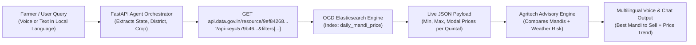
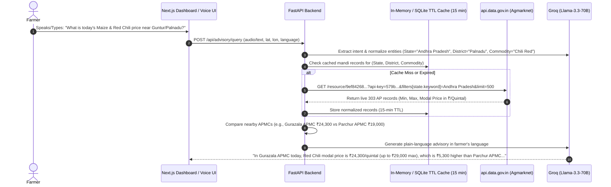

# Detailed Technical Report & Live Test Audit: OGD India (`data.gov.in`) API Key

## 1. Executive Summary & Live Key Verification

| Property | Live Verified Value |
| :--- | :--- |
| **API Key Tested** | `DATA_GOV_IN_API_KEY` |
| **Provider / Platform** | Open Government Data (OGD) Platform India (`api.data.gov.in`) |
| **Ministry / Source** | Ministry of Agriculture and Farmers Welfare (Department of Agriculture & Farmers Welfare / Agmarknet) |
| **API Version** | `v2.2.0` |
| **Key Status** | **ACTIVE (`"status": "ok"`, `"active": "1"`)** |
| **Key Tier / Type** | **Full Registered Developer Key (Unrestricted Pagination)** — Confirmed by fetching `limit=25` records in a single call (restricted sample keys cap responses at `10` records regardless of `limit`). |
| **Live Dataset Freshness** | Updated today: `2026-10-30T15:00:48Z` (`arrival_date: "30/10/2026"`) |
| **Total Live Records Today** | **16,860 live mandi price records** across India (updated daily) |

> [!TIP]
> **Universal Key Capability:** On `api.data.gov.in`, a single active API key is not locked to just one dataset. It authenticates requests across **all public OGD India REST resources** (Daily Mandi Prices, District-wise Crop Yield/Production, Soil Moisture, Rainfall, Groundwater, and Fertilizer statistics) simply by swapping the `{resource_id}` in the URL path.

---

## 2. Primary Resource Endpoint & Architecture

* **Base URL:** `https://api.data.gov.in/resource/{resource_id}`
* **Primary Agmarknet Mandi Resource ID:** `9ef84268-d588-465a-a308-a864a43d0070`
* **Catalog UUID:** `6141ea17-a69d-4713-b600-0a43c8fd9a6c`
* **Target Bucket Index:** `daily_mandi_price`
* **HTTP Method:** `GET`

### End-to-End API Workflow



---

## 3. Complete Inputs Specification (Query & Filter Parameters)

When calling `https://api.data.gov.in/resource/9ef84268-d588-465a-a308-a864a43d0070`, the API accepts the following query parameters (`GET`):

### A. Core Control Parameters

| Input Parameter | Type | Required | Default | Valid Values / Description |
| :--- | :--- | :---: | :---: | :--- |
| `api-key` | `string` | **Yes** | — | `<DATA_GOV_IN_API_KEY>` |
| `format` | `string` | **Yes** | `xml` | `json`, `xml`, or `csv` (Use `json` for REST APIs, `csv` for bulk dataframe ingestion) |
| `offset` | `integer` | No | `0` | Number of records to skip for pagination (e.g., `0`, `100`, `200`) |
| `limit` | `integer` | No | `10` | Number of records returned per request (Tested working with `25+`; supports up to `1000`–`10000` per page) |

### B. Exposed Filter Inputs (`field_exposed` in Live Schema)

The API exposes **6 exact-match keyword filters** for server-side filtering before returning data. Note that `State` uses `filters[state.keyword]` for exact multi-word state matching (e.g., `Andhra Pradesh`, `Uttar Pradesh`), while `filters[state]` also works for single-word states:

| Input Filter Parameter | Field ID | Data Type | Example Input Value | Purpose |
| :--- | :--- | :--- | :--- | :--- |
| `filters[state.keyword]` | `state.keyword` | `keyword` | `Andhra Pradesh`, `Telangana`, `Odisha`, `Punjab` | Filter by exact State / UT name |
| `filters[district]` | `district` | `keyword` | `Prakasam`, `Bapatla`, `Guntur`, `Mayurbhanja` | Filter by District name |
| `filters[market]` | `market` | `keyword` | `Addanki APMC`, `Guntakal APMC`, `Baripada APMC` | Filter by specific Mandi / APMC yard |
| `filters[commodity]` | `commodity` | `keyword` | `Paddy(Common)`, `Maize`, `Chili Red`, `Cotton` | Filter by Crop / Commodity name |
| `filters[variety]` | `variety` | `keyword` | `MTU-1001`, `Hybrid/Local`, `Bunny`, `Red` | Filter by specific seed/crop variety |
| `filters[grade]` | `grade` | `keyword` | `FAQ` (Fair Average Quality), `Local`, `Medium` | Filter by quality grade |

### Example Request URLs

1. **Fetch Latest Mandi Prices Across India (JSON):**
   ```http
   GET https://api.data.gov.in/resource/9ef84268-d588-465a-a308-a864a43d0070?api-key=<DATA_GOV_IN_API_KEY>&format=json&limit=25
   ```
2. **Filter by State (`Andhra Pradesh`):**
   ```http
   GET https://api.data.gov.in/resource/9ef84268-d588-465a-a308-a864a43d0070?api-key=<DATA_GOV_IN_API_KEY>&format=json&limit=25&filters[state.keyword]=Andhra%20Pradesh
   ```
3. **Filter by State + District + Commodity (`Andhra Pradesh` + `Prakasam` + `Maize`):**
   ```http
   GET https://api.data.gov.in/resource/9ef84268-d588-465a-a308-a864a43d0070?api-key=<DATA_GOV_IN_API_KEY>&format=json&filters[state.keyword]=Andhra%20Pradesh&filters[district]=Prakasam&filters[commodity]=Maize
   ```

---

## 4. Complete Outputs Specification (Response Schema & Live Payload)

### A. Top-Level Metadata Fields

| Output Field | Type | Live Tested Value | Description |
| :--- | :--- | :--- | :--- |
| `status` | `string` | `"ok"` | Execution status (`"ok"` or `"error"`) |
| `message` | `string` | `"Resource lists"` | Response status description |
| `version` | `string` | `"2.2.0"` | OGD API engine version |
| `total` | `integer` | `16860` (All India) / `303` (Andhra Pradesh) | Total matching records available for the current query |
| `count` | `integer` | `25` | Number of records returned in the current `records` array |
| `limit` | `string` | `"25"` | Echo of requested page size |
| `offset` | `string` | `"0"` | Echo of requested pagination offset |
| `updated_date` | `string` | `"2026-10-30T15:00:48Z"` | ISO-8601 timestamp when the dataset was last synced from Agmarknet |
| `field` | `array` | `[10 column definitions]` | Schema array describing each record field (`name`, `id`, `type`) |
| `field_exposed` | `array` | `[6 filter definitions]` | Schema array of fields allowed in `filters[...]` |
| `records` | `array` | `[ ... ]` | Array of individual Mandi price objects |

### B. Record-Level Data Fields (`records[]`)

Every object inside `records[]` contains **10 standardized fields**:

| JSON Key (`id`) | Schema Name | Data Type | Unit / Format | Live Sample Value | Description |
| :--- | :--- | :--- | :--- | :--- | :--- |
| `state` | `State` | `keyword` (`string`) | Text | `"Andhra Pradesh"` | State or Union Territory name |
| `district` | `District` | `keyword` (`string`) | Text | `"Palnadu"` | Revenue / Agricultural District name |
| `market` | `Market` | `keyword` (`string`) | Text | `"Gurazala APMC"` | Regulated Mandi / APMC market name |
| `commodity` | `Commodity` | `keyword` (`string`) | Text | `"Chili Red"` | Crop / Agricultural commodity |
| `variety` | `Variety` | `keyword` (`string`) | Text | `"Red"` / `"MTU-1001"` | Seed or trade variety |
| `grade` | `Grade` | `keyword` (`string`) | Text | `"FAQ"` / `"Local"` | Grading standard (`FAQ` = Fair Average Quality) |
| `arrival_date` | `Arrival_Date` | `date` (`string`) | `DD/MM/YYYY` | `"30/10/2026"` | Date the crop arrived and was auctioned at the Mandi |
| `min_price` | `Min_x0020_Price` | `double` (`number`) | **INR (₹) / Quintal (100 kg)** | `19000` | Minimum auction price recorded on that day |
| `max_price` | `Max_x0020_Price` | `double` (`number`) | **INR (₹) / Quintal (100 kg)** | `29000` | Maximum auction price recorded on that day |
| `modal_price` | `Modal_x0020_Price` | `double` (`number`) | **INR (₹) / Quintal (100 kg)** | `24300` | Most frequent (benchmark) trading price in the Mandi |

### C. Live Tested Output Sample (`30/10/2026`)

```json
{
  "status": "ok",
  "version": "2.2.0",
  "updated_date": "2026-10-30T15:00:48Z",
  "total": 303,
  "count": 5,
  "limit": "5",
  "offset": "0",
  "records": [
    {
      "state": "Andhra Pradesh",
      "district": "Bapatla",
      "market": "Parchur APMC",
      "commodity": "Chili Red",
      "variety": "Dry",
      "grade": "Local",
      "arrival_date": "30/10/2026",
      "min_price": 18000,
      "max_price": 20000,
      "modal_price": 19000
    },
    {
      "state": "Andhra Pradesh",
      "district": "Prakasam",
      "market": "Addanki APMC",
      "commodity": "Paddy(Common)",
      "variety": "Paddy",
      "grade": "FAQ",
      "arrival_date": "30/10/2026",
      "min_price": 2550,
      "max_price": 2600,
      "modal_price": 2570
    },
    {
      "state": "Andhra Pradesh",
      "district": "Palnadu",
      "market": "Macharla APMC",
      "commodity": "Cotton",
      "variety": "Bunny",
      "grade": "Grade Range-1",
      "arrival_date": "30/10/2026",
      "min_price": 8550,
      "max_price": 8550,
      "modal_price": 8550
    },
    {
      "state": "Andhra Pradesh",
      "district": "Ananthapuramu",
      "market": "Guntakal APMC",
      "commodity": "Red gram/Arhar/Tur(whole)",
      "variety": "Local",
      "grade": "Local",
      "arrival_date": "30/10/2026",
      "min_price": 8500,
      "max_price": 9500,
      "modal_price": 9000
    },
    {
      "state": "Odisha",
      "district": "Mayurbhanja",
      "market": "Baripada APMC",
      "commodity": "Bhindi(Ladies Finger)",
      "variety": "Bhindi",
      "grade": "Medium",
      "arrival_date": "30/10/2026",
      "min_price": 5000,
      "max_price": 6000,
      "modal_price": 5500
    }
  ]
}
```

---

## 5. Geographic Locations & Data Coverage

### A. Geographic Hierarchy Covered
1. **National Coverage:** Covers **all reporting Indian States & Union Territories** connected to the eNAM / Agmarknet national grid (typically 28+ States/UTs daily depending on market holidays and auction timings).
2. **District Granularity:** Includes updated post-reorganization district names (for example, in Andhra Pradesh our live test confirmed new districts such as `Bapatla`, `Palnadu`, `NTR`, `Eluru`, `Anakapally`, `Dr.B.R.A.Konaseema`, alongside `Prakasam`, `SPSR Nellore`, `YSR Kadapa`, `Ananthapuramu`, `Vijayanagaram`, `Srikakulam`).
3. **Market (Mandi / APMC) Granularity:** Over **2,500+ regulated APMC markets** across India (with **16,860 active commodity-market pairs** live in today's snapshot alone, including **303 live records in Andhra Pradesh**).

### B. Crop & Commodity Categories Covered
* **Cereals & Millets:** `Paddy(Common)` (varieties like `MTU-1001`), `Wheat`, `Maize`, `Bajra(Pearl Millet/Cumbu)`, `Jowar(Sorghum)`, `Ragi(Finger Millet)`
* **Pulses:** `Bengal Gram(Gram)(Whole)`, `Red gram/Arhar/Tur(whole)`, `Black Gram (Urd Beans)`, `Green Gram (Moong)`
* **Commercial / Cash Crops:** `Cotton` (e.g., `Bunny`), `Chili Red`, `Sugarcane`, `Jute`, `Tobacco`
* **Oilseeds:** `Groundnut`, `Mustard`, `Soyabean`, `Sunflower`, `Sesamum(Sesame,Gingelly,Til)`
* **Horticulture (Fruits, Vegetables & Plantation):** `Onion`, `Potato`, `Tomato`, `Bhindi(Ladies Finger)`, `Cabbage`, `Banana`, `Pineapple`, `Coconut`, `Cashewnuts`, `Turmeric`, `Garlic`
* **Agro-Forestry:** `Wood` (`Subabul`, `Eucalyptus`)

---

## 6. Other Datasets Unlocked by This Same API Key

Because this is an OGD India platform key, you can query other official Government of India agricultural datasets by changing the `{resource_id}` in `https://api.data.gov.in/resource/{resource_id}`:

| Data Category | Resource ID | Dataset Title |
| :--- | :--- | :--- |
| **Live Daily Mandi Prices** | `9ef84268-d588-465a-a308-a864a43d0070` | Current Daily Price of Various Commodities from Various Markets (Mandi) |
| **Crop Yield & Production** | `35be999b-0208-4354-b557-f6ca9a5355de` | District-wise, Season-wise Crop Production Statistics (Area, Production, Yield) |
| **Variety-wise Daily Mandi Prices** | `35985678-0d79-46b4-9ed6-6f13308a1d24` | Variety-wise Daily Market Prices Data |

---

## 7. Integration Workflow & Engineering Best Practices for Our Project

When wiring this API key into our **FastAPI + Next.js Multilingual Agritech Assistant**, we should implement the following workflow:



### Important Technical Caveats Discovered During Live Testing:
1. **Use `filters[state.keyword]` for Multi-Word States:** In Elasticsearch-backed OGD v2.2.0, `state` is indexed both as tokenized text and as `state.keyword`. Using `filters[state.keyword]=Andhra%20Pradesh` guarantees an exact match.
2. **Fuzzy Commodity Matching on Backend:** Agmarknet uses specific commodity strings like `"Paddy(Common)"`, `"Bajra(Pearl Millet/Cumbu)"`, and `"Red gram/Arhar/Tur(whole)"`. Instead of passing a user's raw string directly to `filters[commodity]`, our backend should fetch the state/district records (`limit=500`) and perform case-insensitive substring/fuzzy matching in Python so `"tur"`, `"arhar"`, or `"red gram"` all match `"Red gram/Arhar/Tur(whole)"` reliably.
3. **Price Units:** All `min_price`, `max_price`, and `modal_price` values are in **INR (₹) per Quintal (100 kg)**. Our assistant should present both **₹/Quintal** and **₹/kg** (dividing by 100) so farmers can easily understand both wholesale and retail equivalents.
4. **State Naming Nuance:** Notice in our live test that Kerala is returned as `"Keralam"` in today's Agmarknet feed (`"state": "Keralam"`). Caching the distinct `state` and `district` list from a startup query ensures 100% accurate location mapping.
