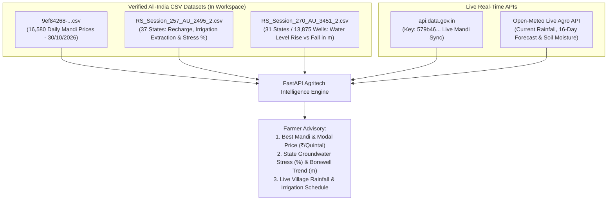

# Comprehensive Audit & Technical Report of Uploaded CSV Datasets

## 1. Executive Summary & Dataset Inventory

We inspected all **5 CSV files** uploaded into `c:\Users\racha\Downloads\new project`. Below is the master inventory, data freshness (year/date), geographic coverage, and final inclusion verdict for our **Multilingual Agritech & Resource Advisory Assistant**:

| File Name | Size | Rows | Data Year / Date | Geographic Scope | Category | Final Verdict |
| :--- | :--- | :---: | :---: | :--- | :--- | :--- |
| **`9ef84268-d588-465a-a308-a864a43d0070.csv`** | 1.65 MB | 16,580 | **`30/10/2026`** (Current) | **All-India** (28+ States/UTs, 2,500+ Mandis) | Market Prices of Crops (Mandi) | ✅ **KEEP (Primary Baseline + Live API)** |
| **`RS_Session_257_AU_2495_2.csv`** | 2.13 KB | 38 | CGWB Dynamic Resource Assessment | **All-India** (37 States/UTs) | Groundwater Volume, Recharge & Irrigation Stress (`BCM` & `%`) | ✅ **KEEP (Macro Groundwater Stress Index)** |
| **`RS_Session_270_AU_3451_2.csv`** | 2.97 KB | 32 | **Rajya Sabha Session 270** (Latest) | **All-India** (31 States/UTs, 13,875 Wells) | Borewell Water Table Depth Fluctuation (`Rise` vs. `Fall` in meters) | ✅ **KEEP (Borewell Water-Level Trend)** |
| **`WBC_AS.csv`** | 60.06 MB | 172,492 | `1836–2021` (Construction/Renovation) | **Assam Only** | 1st Census of Water Bodies (Ponds/Tanks) | ❌ **DROP / ARCHIVE** (Single-state, static census) |
| **`TNDAMSLIST_1_0.csv`** | 29.86 KB | 120 | `1895–2015` (Year of Completion) | **Tamil Nadu Only** | Static Dam Engineering Directory | ❌ **DROP / ARCHIVE** (Single-state, no live water levels) |

---

## 2. Deep-Dive Comparison: The Two All-India Groundwater Datasets

### A. `RS_Session_257_AU_2495_2.csv` (Groundwater Volumetric Reserves & Irrigation Extraction)

* **Purpose:** Quantifies the **total volume of water** recharged annually versus how much is pumped out specifically for **agricultural irrigation** across all 37 States and Union Territories.
* **Unit of Measurement:** **BCM** (Billion Cubic Meters, where $1\text{ BCM} = 10^9\text{ m}^3$) and Percentage (`%`).

#### Complete Schema (8 Columns)

| Column # | Column Header | Type | Description |
| :---: | :--- | :--- | :--- |
| `1` | `Sl. No.` | `integer` | Serial number (`1` to `37`, plus `Grand Total`) |
| `2` | `States/Union Territories` | `string` | Primary join key (State / UT name) |
| `3` | `Total Annual Ground Water Recharge (in BCM)` | `float` | Total annual replenishment from monsoon rainfall, canals, and surface bodies (`All-India Total: 436.15 BCM`) |
| `4` | `Annual Extractable Ground Water Resource (in BCM)` | `float` | Net groundwater available for human/agricultural use after natural discharge (`All-India Total: 397.62 BCM`) |
| `5` | `Current Annual Ground Water Extraction (in BCM) - Irrigation` | `float` | **Volume pumped specifically for agricultural crops** (`All-India Total: 217.61 BCM` — **88.8% of all extraction**) |
| `6` | `Current Annual Ground Water Extraction (in BCM) - Industrial & Domestic` | `float` | Volume pumped for drinking, domestic, and industrial use (`All-India Total: 27.30 BCM`) |
| `7` | `Current Annual Ground Water Extraction (in BCM) - Total` | `float` | Combined annual extraction (`All-India Total: 244.92 BCM`) |
| `8` | `Stage of Ground Water Extraction (%)` | `float` | $\frac{\text{Total Extraction}}{\text{Annual Extractable Resource}} \times 100$ (`All-India Average: 61.6%`) |

---

### B. `RS_Session_270_AU_3451_2.csv` (Borewell / Piezometer Water Table Rise vs. Fall)

* **Purpose:** Published in **Rajya Sabha Session 270**, this dataset tracks **actual physical water-level changes (in meters)** across **13,875 CGWB monitoring wells** nationwide.
* **Unit of Measurement:** Number of Monitoring Wells (`Count`), Share of Wells (`%`), and Water Level Shift Bands (`0 to 2 meters`, `2 to 4 meters`, `> 4 meters`).

#### Complete Schema (17 Columns)

| Column # | Column Header | Type | Description |
| :---: | :--- | :--- | :--- |
| `1` | `Sl. No.` | `integer` | Serial number (`1` to `31`, plus `Total`) |
| `2` | `State/UT` | `string` | Primary join key (State / UT name) |
| `3` | `No of Wells Analysed` | `integer` | Total CGWB piezometer/monitoring wells tracked in the state (`All-India: 13,875 wells`) |
| `4` | `...Rise - 0 to 2` | `integer` | Wells where water table **rose by 0–2m** (`7,328` wells) |
| `5` | `...Rise - %` (0 to 2m) | `float` | `%` of state wells rising by 0–2m (`52.8%` nationwide) |
| `6` | `...Rise - 2 to 4` | `integer` | Wells where water table **rose by 2–4m** (`1,777` wells) |
| `7` | `...Rise - %` (2 to 4m) | `float` | `%` of state wells rising by 2–4m (`12.8%` nationwide) |
| `8` | `...Rise - > 4` | `integer` | Wells where water table **rose by > 4m** (`1,059` wells) |
| `9` | `...Rise - %` (> 4m) | `float` | `%` of state wells rising by > 4m (`7.6%` nationwide) |
| `10` | `...Fall - 0 to 2` | `integer` | Wells where water table **dropped by 0–2m** (`3,037` wells) |
| `11` | `...Fall - %` (0 to 2m) | `float` | `%` of state wells dropping by 0–2m (`21.9%` nationwide) |
| `12` | `...Fall - 2 to 4` | `integer` | Wells where water table **dropped by 2–4m** (`382` wells) |
| `13` | `...Fall - %` (2 to 4m) | `float` | `%` of state wells dropping by 2–4m (`2.8%` nationwide) |
| `14` | `...Fall - > 4` | `integer` | Wells with **severe water table drop > 4m** (`243` wells) |
| `15` | `...Fall - %` (> 4m) | `float` | `%` of state wells with severe drop > 4m (`1.8%` nationwide) |
| `16` | `Total No. of wells - Rise` | `integer` | Total wells showing positive recharge (`10,164` wells = `73.25%`) |
| `17` | `Total No. of wells - Fall` | `integer` | Total wells showing groundwater depletion (`3,662` wells = `26.39%`) |

---

### C. Combined State-by-State Snapshot (Joining Both Files)

By joining `RS_Session_257_AU_2495_2.csv` and `RS_Session_270_AU_3451_2.csv` on `State/UT`, our system derives both **Structural Extraction Stress** and **Current Borewell Water Table Trend**:

| State / UT | Annual Recharge (`BCM`) | Irrigation Extraction (`BCM`) | Extraction Stage (`%`) | CGWB Zone Classification | Wells Analysed | Wells Rising (`%`) | Wells Falling (`%`) | Severe Drop `>4m` (`%`) |
| :--- | :---: | :---: | :---: | :--- | :---: | :---: | :---: | :---: |
| **Punjab** | `22.80` | `32.80` | **`164.42%`** | 🔴 **Over-Exploited** | `185` | `57.3%` | **`42.2%`** | **`12.4%`** |
| **Rajasthan** | `12.24` | `14.37` | **`150.22%`** | 🔴 **Over-Exploited** | `849` | `70.4%` | `29.4%` | **`8.6%`** |
| **Haryana** | `9.53` | `10.47` | **`134.56%`** | 🔴 **Over-Exploited** | `243` | `61.7%` | **`38.3%`** | **`9.1%`** |
| **Tamil Nadu** | `19.59` | `13.52` | **`82.93%`** | 🟠 **Critical / Semi-Critical** | `800` | `79.1%` | `20.4%` | `1.9%` |
| **Uttar Pradesh** | `72.20` | `41.29` | **`68.83%`** | 🟡 **Moderate-High** | `569` | `71.7%` | `28.3%` | `1.1%` |
| **Karnataka** | `18.16` | `9.60` | **`64.85%`** | 🟡 **Moderate-High** | `1,110` | `68.6%` | `31.1%` | `1.1%` |
| **Madhya Pradesh**| `36.16` | `17.33` | `56.82%` | 🟢 **Safe** | `1,036` | `82.8%` | `17.0%` | `1.4%` |
| **Maharashtra** | `32.01` | `15.29` | `54.99%` | 🟢 **Safe** | `1,580` | `80.1%` | `19.7%` | `1.2%` |
| **Gujarat** | `26.81` | `12.65` | `53.39%` | 🟢 **Safe** | `636` | `72.8%` | `27.2%` | `2.4%` |
| **Telangana** | `16.63` | `7.13` | `53.32%` | 🟢 **Safe** | `394` | **`91.1%`** | `8.6%` | `0.5%` |
| **Bihar** | `28.05` | `10.33` | `51.14%` | 🟢 **Safe** | `591` | `63.6%` | `35.9%` | `0.0%` |
| **West Bengal** | `29.33` | `10.84` | `44.60%` | 🟢 **Safe** | `606` | `80.9%` | `18.6%` | `0.8%` |
| **Odisha** | `17.08` | `5.50` | `43.65%` | 🟢 **Safe** | `1,171` | `69.6%` | `29.6%` | `0.1%` |
| **Andhra Pradesh**| `24.15` | `6.60` | **`33.26%`** | 🟢 **Safe** | `603` | **`88.7%`** | `11.3%` | `0.5%` |

---

## 3. Audit of the Remaining 3 CSV Files in Workspace

### 1. `9ef84268-d588-465a-a308-a864a43d0070.csv` (All-India Daily Mandi Crop Prices)
* **Verdict:** ✅ **KEEP**
* **Rows:** `16,580` commodity-market price records.
* **Date:** `30/10/2026` (Matches the live `api.data.gov.in` endpoint we tested).
* **Columns (10):** `State`, `District`, `Market`, `Commodity`, `Variety`, `Grade`, `Arrival_Date`, `Min_x0020_Price`, `Max_x0020_Price`, `Modal_x0020_Price` (in ₹/Quintal).
* **Role in Project:** Serves as an instant, zero-latency local dataset of 16,580 real mandi prices across India while our backend also queries the live `api.data.gov.in` API for real-time updates.

### 2. `WBC_AS.csv` (First Census of Water Bodies — Assam)
* **Verdict:** ❌ **NOT RECOMMENDED FOR CORE ENGINE**
* **Rows:** `172,492` rows (`60.06 MB`).
* **Year Range:** `construcion_year` (`1836–2021`), `renovation_year` (`1961–2020`), `scheme_inclusion_year` (`2011–2017`).
* **Why to exclude:** Covers **only Assam** and contains static pond construction history rather than current groundwater or rainfall metrics. Its 60 MB size also bloats memory unnecessarily.

### 3. `TNDAMSLIST_1_0.csv` (Tamil Nadu Dams Directory)
* **Verdict:** ❌ **NOT RECOMMENDED FOR CORE ENGINE**
* **Rows:** `120` dams (`29.86 KB`).
* **Year Range:** `Year of Completion` (`1895–2015`).
* **Why to exclude:** Covers **only Tamil Nadu** and only lists static dam dimensions (`Length`, `Height`, `Gross storage capacity`, `FRL`) without live reservoir water storage levels.

---

## 4. Data Pipeline Architecture: How the Accepted Files Work Together

