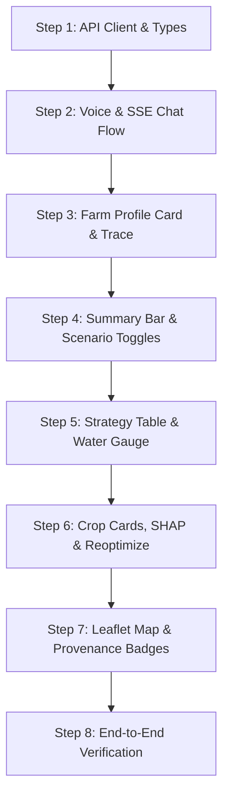

# AgriPulse Frontend Integration Plan

> [!IMPORTANT]
> **Backend & ML Pipeline Status**: Fully Operational (140/140 tests passing).
> The ML engine (ML.3 Baseline, ML.4 Model A Gradient Boosting, ML.4b SHAP Explainability, ML.5 Climate Scenarios, and ML.6–OPT.3 Optimization) is live.
> All endpoints return real computed agro-climatic data across 36 Maharashtra districts.

This document details:
1. Complete API endpoint contracts and real SSE event specifications.
2. Verified payload schemas reflecting current backend and ML models.
3. Screen-by-screen data binding and UI state requirements.
4. Step-by-step build roadmap for seamless frontend integration without breaking changes.

---

## Part 1: Endpoints at a Glance

| Method | Path | Consumer | Response Shape / Type | Notes |
|---|---|---|---|---|
| `POST` | `/api/agent/chat` | S1 Home (Mic/Chat) | SSE Stream (`text/event-stream`) | Primary conversation & planning flow |
| `POST` | `/api/plan` | Direct Plan Call / Tests | `PlanResult` JSON | Synchronous complete plan evaluation |
| `POST` | `/api/plans/{plan_id}/reoptimize` | S4 Dashboard Risk Slider | `PlanResult` JSON (version 2+) | Sub-second recalculation |
| `GET` | `/api/threads/{thread_id}` | App Rehydration / Reload | `{profile, messages, plan}` | Restores session state from `localStorage` |
| `POST` | `/api/transcribe` | S1 Mic Button | `{transcript, language_code}` | Sarvam ASR (`audio/webm`, `audio/mp4`) |
| `POST` | `/api/speak` | Audio Play Button | `{audio_base64, content_type}` | Sarvam TTS (`audio/mpeg`) |
| `POST` | `/api/prefetch` | District Resolution Hook | `{status: "queued"}` | Fire-and-forget prefetch of weather/mandi |
| `GET` | `/api/locations/search?q={query}` | S2 Location Search Autocomplete | `list[LocationSearchResult]` | Open-Meteo geocoding filtered to Maharashtra |
| `GET` | `/api/districts` | Map View / District Picker | `{districts: list[District]}` | 36 districts with `is_agricultural_district` flag |
| `GET` | `/api/districts/{district}/context` | Map Marker Popup | `DistrictContext` | Soil NPK, groundwater status, reservoir storage |
| `GET` | `/api/sources` | S6 Sources Page | `{sources: list[DataSource]}` | Transparent data catalog with verified dates |
| `GET` | `/api/sources/health` | S6 Sources Health Indicator | `{health: list[SourceHealth]}` | Upstream service availability and latency |
| `GET` | `/api/health` | Cold-Start Polling / Readiness | `{status: "ok", version: "1.0.0"}` | Returns 200 when ready; poll during startup |

Base URL: `http://localhost:8000` in local development · `VITE_API_URL` environment variable in production.

---

## Part 2: E1 SSE Agent Chat Specification

The conversational workflow streams structured events over Server-Sent Events (`text/event-stream`).

### Request Contract
```http
POST /api/agent/chat
Content-Type: application/json

{
  "message": "Pune, 5 acres, 80000 rupees, borewell with drip, balanced risk",
  "language": "mr",
  "thread_id": "th_41d9a2",
  "profile_patch": null
}
```

- `message`: Farmer's speech transcript or typed query.
- `language`: `"mr"` (Marathi), `"hi"` (Hindi), or `"en"` (English).
- `thread_id`: `null` on first turn; persist the returned thread ID for all subsequent turns.
- `profile_patch`: Optional dictionary (e.g., `{"land_acres": 6.0, "budget_rs": 90000.0}`) when modifying farm profile fields directly.

### SSE Stream Event Protocol

Each SSE chunk follows standard `event: <name>\ndata: <json>\n\n` formatting:

| Event Name | Emit Timing | Payload Structure | Frontend Action |
|---|---|---|---|
| `thread` | Immediate (Turn Start) | `{"thread_id": "th_41d9a2"}` | Persist to `localStorage` and Zustand store. |
| `profile` | Profile Extracted/Updated | `FarmProfile` | Update S2 Farm Profile Card with parsed details and assumed tags. |
| `trace` | Per Pipeline Execution Step | `TraceEvent` | Append live item to S3 Trace Timeline (status, duration, source). |
| `question` | Incomplete Profile | `{"text": "...", "field": "land_acres", "language": "mr"}` | Render prompt in chat window, trigger TTS playback, enable mic. |
| `plan` | Pipeline Finished | `PlanResult` | Mount S4 Dashboard with allocations, scenarios, and strategies. |
| `done` | Stream Complete | `{"ms": 1420}` | Terminate loading spinners, re-enable input fields. |
| `error` | Processing Failure | `ApiError` | Render localized error state with retry button. |

### Robust TypeScript SSE Client
```typescript
export interface ChatRequest {
  message: string;
  language: 'mr' | 'hi' | 'en';
  thread_id?: string | null;
  profile_patch?: Record<string, unknown> | null;
}

export async function streamChat(
  req: ChatRequest,
  onEvent: (event: string, data: any) => void,
  signal?: AbortSignal
): Promise<void> {
  const response = await fetch(`${import.meta.env.VITE_API_URL || ''}/api/agent/chat`, {
    method: 'POST',
    headers: { 'Content-Type': 'application/json' },
    body: JSON.stringify(req),
    signal,
  });

  if (!response.ok || !response.body) {
    throw new Error(`Chat stream failed: HTTP ${response.status}`);
  }

  const reader = response.body.getReader();
  const decoder = new TextDecoder();
  let buffer = '';
  let eventType = 'message';

  while (true) {
    const { done, value } = await reader.read();
    if (done) break;

    buffer += decoder.decode(value, { stream: true });
    const lines = buffer.split('\n');
    buffer = lines.pop() || '';

    for (const line of lines) {
      const trimmed = line.trim();
      if (!trimmed) continue;

      if (trimmed.startsWith('event:')) {
        eventType = trimmed.slice(6).trim();
      } else if (trimmed.startsWith('data:')) {
        const rawJson = trimmed.slice(5).trim();
        try {
          const parsed = JSON.parse(rawJson);
          onEvent(eventType, parsed);
        } catch (err) {
          console.error('Failed to parse SSE JSON:', rawJson, err);
        }
        eventType = 'message';
      }
    }
  }
}
```

---

## Part 3: Data Contracts & Payload Schemas

### 1. `PlanResult` Root Structure
```typescript
export interface PlanResult {
  plan_id: string;                       // e.g. "pl_9b3e10"
  thread_id: string;                     // e.g. "th_41d9a2"
  version: number;                       // 1 on creation, increments on reoptimization
  previous_version: number | null;
  created_at: string;                    // ISO timestamp
  profile: FarmProfile;                  // Effective farmer inputs
  location: Location;                    // Resolved coordinates and district
  season: Season;                        // Detected season (Kharif, Rabi, Summer)
  scenarios: Scenario[];                 // Array of exactly 3: drought, normal, excess
  crops: CropOption[];                   // Filtered candidate crops with full metrics
  excluded_crops: ExcludedCrop[];        // Crops ruled out and explicit reasons
  water: WaterBudget[];                  // Water budgets per scenario [drought, normal, excess]
  strategies: StrategyResult[];          // Comparison portfolio strategies (up to 4)
  recommended_strategy: StrategyId | null; // e.g. "qp_balanced" (ID string, not object)
  impact: ImpactResult | null;           // Quantified savings vs traditional practice
  infeasibility: Infeasibility | null;   // Provided only when parameters prevent viable plans
  explanation: Explanation;              // Grounded summary text in requested language
  warnings: Warning[];                   // System alerts (e.g. OLD_COST_YEAR, ASSUMED_IRRIGATION)
  data_status: DataStatus;               // Count of live, cached, and official records
}
```

### 2. `CropOption` & ML Outputs
```typescript
export interface CropOption {
  crop_id: string;
  names: { en: string; mr: string; hi: string };
  season: string;
  suitability: Suitability;
  yield_quintal_per_acre: {
    drought: number;
    normal: number;
    excess: number;
  };
  price: SourcedValue;                   // Today's mandi benchmark quote
  expected_harvest_price: SourcedValue;  // Seasonally adjusted price at harvest
  seasonal_ratio: SourcedValue;          // Historical 5-year price variation multiplier
  duration_days: number;                 // Maturity period in days
  harvest_month: string;                 // Expected harvest format: "YYYY-MM"
  opens_on: string | null;               // Sowing start date if window opens in the future
  msp: SourcedValue | null;              // Official minimum support price
  cost_per_acre: CostBreakdown;          // Itemized cost from CACP + RDF fertilizer overrides
  fertilizer: FertilizerPlan;            // Recommended dose and bag breakdown
  water_need_m3_per_acre: {
    drought: number;
    normal: number;
    excess: number;
  };
  profit_rs_per_acre: {
    drought: number;
    normal: number;
    excess: number;
  };
}

export interface Suitability {
  score: number;                         // Ratio of predicted yield to 3-year district baseline
  label: 'good' | 'average' | 'poor';    // good (>=1.05), average (0.90-1.05), poor (<0.90)
  top_factors: SuitabilityFactor[];      // Top 3 SHAP feature drivers
  fallback_used: boolean;
}

export interface SuitabilityFactor {
  feature: string;                       // Fixed code (e.g. "rainfall_departure_pct", "et0_total_mm")
  value: number;                         // Measured physical value
  unit: string;                          // Measurement unit (e.g. "mm", "°C", "%")
  effect_quintal_per_acre: number;       // SHAP impact on final crop yield in q/acre
  direction: 'up' | 'down';              // Positive or negative impact direction
}
```

### 3. `StrategyResult` Optimization Model
```typescript
export type StrategyId = 'traditional' | 'lp_max_profit' | 'qp_balanced' | 'qp_drought_safe';
export type StrategyKind = 'traditional' | 'lp' | 'qp';

export interface Allocation {
  crop_id: string;
  acres: number;                         // Allocated acreage
  share_pct: number;                     // Percentage of arable land
  cost_rs: number;                       // Total cultivation expenditure for this crop
  water_m3: number;                      // Total irrigation volume consumed
  profit_rs: {                           // Total net return across scenarios
    drought: number;
    normal: number;
    excess: number;
  };
}

export interface StrategyResult {
  id: StrategyId;
  label: string;
  kind: StrategyKind;
  risk_lambda: number;                   // Variance aversion parameter (0.0 to 1.0)
  safety_scenario: 'drought' | 'normal' | 'excess';
  allocations: Allocation[];
  totals: {
    land_used_acres: number;
    budget_used_rs: number;
    water_m3: {
      drought: number;
      normal: number;
      excess: number;
    };
    cost_rs: number;
  };
  profit_by_scenario_rs: {
    drought: number;
    normal: number;
    excess: number;
  };
  expected_profit_rs: number;            // Probability-weighted expected profit
  worst_case_profit_rs: number;          // Minimum profit across all 3 scenarios
  feasible: boolean;
  binding_constraints: string[];         // e.g. ["water", "land", "budget"]
  relaxations_applied: Array<{ step: string; result: string }>;
  solver?: { solver: string; solve_time_ms: number; status: string };
  infeasibility?: Infeasibility | null;
}
```

### 4. `SourcedValue` Transparency Block
Every numerical datapoint visible to the farmer incorporates provenance metadata:
```typescript
export interface SourcedValue {
  value: number;
  unit: string;
  source: string;
  source_url?: string;
  as_of?: string;                        // ISO date string or publication year
  status: 'live' | 'cached' | 'official_dataset' | 'model' | 'computed' | 'farmer_input' | 'assumption';
  history_years?: number;
  note?: string;
}
```

---

## Part 4: Screen to API Mapping

### Screen S1: Home (Voice & Chat)
- **Primary Input**: Hold/tap `<MicButton>` captures audio stream.
- **Audio Check**: Validates `MediaRecorder.isTypeSupported('audio/webm;codecs=opus')` with fallback to `audio/mp4` for Safari / iOS devices.
- **ASR Dispatch**: Audio payload is dispatched to `POST /api/transcribe`, resolving to `{transcript, language_code}`.
- **Agent Invocation**: The resolved transcript is posted to `POST /api/agent/chat`.
- **Question State**: If a `question` event is received (e.g. missing borewell hours), the question text is displayed prominently and audio is synthesized via `POST /api/speak`.

### Screen S2: Farm Profile Card
- **Data Source**: Populated from the `profile` SSE event or `PlanResult.profile`.
- **Field Rendering**:
  - District location (with edit toggle triggering `GET /api/locations/search`).
  - Total arable acreage.
  - Working budget (formatted in Indian currency notation, e.g. ₹80,000).
  - Water sources (borewell, canal, rainfed) and irrigation method.
- **Assumption Chips**: Any field listed in `profile.defaults_used` is displayed with an amber `<SourceBadge status="assumption">` and basis explanation tooltip.
- **Interactive Patching**: Tapping ✏️ to update acreage or budget dispatches `profile_patch` to `/api/agent/chat` or triggers `/api/plans/{plan_id}/reoptimize`.

### Screen S3: Agent Reasoning Trace Timeline
- **Data Source**: Populates incrementally as `trace` events are received.
- **Step Visuals**:
  - `status: "running"`: Animated pulsing spinner.
  - `status: "ok"`: Green checkmark with step duration (e.g. `0.4s`).
  - `status: "cached"`: Amber badge indicating cached fallback.
  - `status: "failed"`: Red indicator showing the fallback applied.
- **Provenance Badges**: Displays source name (e.g., "Open-Meteo ERA5", "CACP Cost of Cultivation", "Agmarknet").

### Screen S4: Strategic Plan Dashboard

```
┌────────────────────────────────────────────────────────────────────────┐
│ S4 Plan Dashboard Architecture                                         │
├────────────────────────────────────────────────────────────────────────┤
│ 1. Summary Metrics Bar (Expected Profit, Worst Case, Water/Fert Saved) │
│ 2. Climate Scenario Selector: [Drought P10] [Normal P50] [Excess P90]  │
│ 3. Risk Profile Slider: (Safe λ=1.0) ─── (Balanced) ─── (Max Profit)   │
│ 4. Portfolio Allocation Donut Chart + Sowing Breakdown List            │
│ 5. Strategy Comparison Table & Interactive Profit Trade-off Chart     │
│ 6. Water Budget Semicircle Gauge (Demand vs Groundwater/Canal Supply)  │
│ 7. Fertilizer Plan (RDF Doses & Official MRP Bag Counts)               │
│ 8. Crop Option Cards with "Why this Crop?" SHAP Explainability Factors │
│ 9. Excluded Crops List with Explicit Disqualification Reasons          │
│ 10. Agro-Climatic Leaflet Map with District Groundwater Risk Shading   │
└────────────────────────────────────────────────────────────────────────┘
```

#### A. Scenario Selector (Drought / Normal / Excess)
- Binds to `PlanResult.scenarios`.
- Displays analogue year context (e.g., "Normal (P50) · Analogue 2011 · 60% probability", "Drought (P10) · Analogue 1999 · 20% probability").
- Toggling shifts all visible columns (yields, water requirements, and net profits) to the chosen scenario.

#### B. Risk Slider & Real-Time Reoptimization
- Three discrete notches: Safe (0), Balanced (1), Max Profit (2).
- On change, dispatches:
  ```http
  POST /api/plans/{plan_id}/reoptimize
  Content-Type: application/json

  { "risk_appetite": "safe" }
  ```
- Sub-second response updates allocations and strategy metrics with smooth numeric animations.

#### C. Water Budget Gauge
- Accesses `PlanResult.water.find(w => w.scenario === selectedScenario)`.
- Total arc represents available water (`available_m3.total.value`).
- Filled indicator denotes required volume (`need_m3.recommended_plan.value`).
- Breakdown chips below the gauge display rain contribution, permissible groundwater extraction, and canal release.
- Includes categorical groundwater alert (`Safe`, `Semi-critical`, `Critical`, `Over-exploited`).

#### D. Fertilizer Plan & Bag Conversion
- Renders `CropOption.fertilizer` with university RDF doses.
- Explicitly presents required physical bags:
  - Urea (45 kg bags @ ₹266.50 statutory price)
  - DAP (50 kg bags @ ₹1,350 NBS notification price)
  - MOP (50 kg bags @ ₹1,655 NBS notification price)
- Highlights total input cost per acre.

#### E. Crop Cards & "Why this Crop?" SHAP Breakdown
- Renders each option with suitability label badge (`good` green, `average` amber, `poor` red).
- Displays top 3 SHAP drivers from `suitability.top_factors`:
  - Code mapping:
    - `rainfall_departure_pct` → "Monsoon rainfall deviation"
    - `et0_total_mm` → "Evaporative water demand"
    - `mean_temp_c` → "Growing season temperature"
    - `heat_stress_days` → "Heat stress exposure days"
    - `soil_n_kg_ha` → "Soil nitrogen level"
    - `soil_p_kg_ha` → "Soil phosphorus availability"
    - `soil_k_kg_ha` → "Soil potassium level"
  - Format: `↑ Growing season temperature 24.0°C adds +0.44 q/acre` or `↓ Evaporative demand 783 mm reduces -0.49 q/acre`.

#### F. Excluded Crops
- Displays crops filtered out with standardized reasons from `PlanResult.excluded_crops`:
  - `NO_REAL_PRICE`: "No official market price reported in {district}"
  - `NO_YIELD_DATA`: "No historical crop yield data on record"
  - `NOT_SOWABLE_NOW`: "Sowing window closed for current season"
  - `NOT_GROWN_IN_DISTRICT`: "Not traditionally cultivated in {district}"
  - `WATER_INFEASIBLE`: "Water requirements exceed available farm supply"
  - `OVER_BUDGET`: "Cultivation expenses exceed available capital"

---

## Part 5: State Architecture (Zustand & TanStack Query)

```typescript
// src/state/store.ts
import { create } from 'zustand';
import { persist } from 'zustand/middleware';
import type { PlanResult, FarmProfile, TraceEvent, ScenarioId, StrategyId } from '../api/types';

interface AgriPulseState {
  // Session Persistence
  threadId: string | null;
  planId: string | null;
  language: 'mr' | 'hi' | 'en';
  
  // Dashboard Interactive State
  selectedScenario: ScenarioId;
  selectedStrategy: StrategyId;
  
  // Active Plan & Agent State
  plan: PlanResult | null;
  profile: FarmProfile | null;
  traceEvents: TraceEvent[];
  isStreaming: boolean;
  activeQuestion: string | null;
  
  // State Mutators
  setThreadId: (id: string | null) => void;
  setLanguage: (lang: 'mr' | 'hi' | 'en') => void;
  setSelectedScenario: (sc: ScenarioId) => void;
  setSelectedStrategy: (st: StrategyId) => void;
  setPlan: (plan: PlanResult | null) => void;
  setProfile: (profile: FarmProfile | null) => void;
  appendTraceEvent: (event: TraceEvent) => void;
  clearTrace: () => void;
  setIsStreaming: (loading: boolean) => void;
  setActiveQuestion: (q: string | null) => void;
  resetSession: () => void;
}

export const useAgriPulseStore = create<AgriPulseState>()(
  persist(
    (set) => ({
      threadId: null,
      planId: null,
      language: 'mr',
      selectedScenario: 'normal',
      selectedStrategy: 'qp_balanced',
      plan: null,
      profile: null,
      traceEvents: [],
      isStreaming: false,
      activeQuestion: null,

      setThreadId: (id) => set({ threadId: id }),
      setLanguage: (language) => set({ language }),
      setSelectedScenario: (selectedScenario) => set({ selectedScenario }),
      setSelectedStrategy: (selectedStrategy) => set({ selectedStrategy }),
      setPlan: (plan) => set({
        plan,
        planId: plan?.plan_id ?? null,
        selectedStrategy: plan?.recommended_strategy ?? 'qp_balanced'
      }),
      setProfile: (profile) => set({ profile }),
      appendTraceEvent: (event) => set((s) => ({ traceEvents: [...s.traceEvents, event] })),
      clearTrace: () => set({ traceEvents: [] }),
      setIsStreaming: (isStreaming) => set({ isStreaming }),
      setActiveQuestion: (activeQuestion) => set({ activeQuestion }),
      resetSession: () => set({
        threadId: null,
        planId: null,
        plan: null,
        profile: null,
        traceEvents: [],
        activeQuestion: null
      }),
    }),
    {
      name: 'agripulse_session',
      partialize: (state) => ({
        threadId: state.threadId,
        language: state.language,
      }),
    }
  )
);
```

---

## Part 6: Step-by-Step Implementation Roadmap



### Stage 1: API Foundations & TypeScript Synchronization
- Update `src/api/types.ts` to match current backend schemas.
- Ensure `PlanResult.water` is typed as `WaterBudget[]` and `recommended_strategy` is typed as `StrategyId`.
- Verify `SourceBadge.tsx` covers all status codes (`live`, `cached`, `official_dataset`, `model`, `computed`, `farmer_input`, `assumption`).

### Stage 2: Audio Recording & SSE Streaming Pipeline
- Finalize `src/features/chat/useRecorder.ts` with cross-browser audio codec negotiation.
- Integrate `streamChat` in `src/pages/HomePage.tsx`, dispatching received events into `useAgriPulseStore`.
- Implement `TraceTimeline.tsx` animating pipeline execution nodes.

### Stage 3: Farm Profile Card & Assumed Field Annotations
- Implement `FarmProfileCard.tsx` rendering extracted fields.
- Attach `<SourceBadge status="assumption">` to fields resolved from district defaults (`profile.defaults_used`).
- Wire inline modal enabling direct parameter edits.

### Stage 4: Scenario Toggle & Strategy Comparison
- Bind `ScenarioToggle.tsx` to `plan.scenarios`, highlighting analogue years (e.g. 1999 Drought, 2011 Normal).
- Implement `ComparisonPage.tsx` rendering grouped bar charts comparing Expected Profit, Worst-Year Return, and Irrigation Demand across the 4 strategies.

### Stage 5: Resource Gauges & Fertilizer Specifications
- Build Semicircle Water Gauge comparing required crop water against sustainable groundwater and canal quotas.
- Implement `FertilizerSummary.tsx` showing both elemental nutrient doses (kg/acre) and physical bag counts for Urea, DAP, and MOP.

### Stage 6: Crop Cards & SHAP Explainability
- Implement `CropCard.tsx` displaying scenario-adjusted yield and gross profit.
- Render collapsible "Why this Crop?" section parsing `top_factors` into translated physical drivers.

### Stage 7: Leaflet Map & Cold-Start Polling
- Implement React-Leaflet Maharashtra map color-coding districts by groundwater status.
- Add cold-start retry banner in `AppShell.tsx` polling `/api/health` upon 503 responses.

### Stage 8: Quality Assurance & Acceptance Testing
- Execute unit test suite verifying formatting utilities and badge coverage.
- Perform responsive audit on 360 px viewport.
- Confirm zero broken LaTeX formatting across all views.

---

## Part 7: Developer Setup & Verification Commands

### 1. Starting Backend & Frontend
```bash
# Terminal 1: Backend API (from repo root)
cd backend
python -m uvicorn app.main:app --reload --port 8000

# Terminal 2: Frontend Vite Server (from frontend directory)
cd frontend
npm install
npm run dev
```

### 2. Validation & Smoke Test
```bash
# Verify backend readiness
curl http://localhost:8000/api/health

# Verify direct plan response with ML integration
curl -X POST http://localhost:8000/api/plan \
  -H "Content-Type: application/json" \
  -d '{"location_text":"Pune","land_acres":5.0,"budget_rs":70000.0,"water_source":"borewell","irrigation_method":"drip","risk_appetite":"balanced","language":"mr"}'

# Execute backend unit test suite
cd backend
python -m pytest tests/ -v
```

---

## Part 8: Strict UI & Engineering Invariants

1. **No Bare Numbers**: Every visible numerical metric must be paired with its `<SourceBadge status="...">`.
2. **No Invented Values**: Missing data must display localized fallback notices ("Data unavailable for this district").
3. **Farmer-Centric Units**: Display values in acres (never hectares), quintals (never tonnes or kg/ha), and Indian currency format (₹1,00,000). Convert water volumes to tanker loads (1 tanker = 10 m³) and fertilizer to standardized commercial bags.
4. **Persistent Threads**: Always store `thread_id` in `localStorage` to ensure instant recovery on browser reload without re-computation.
5. **Zero Broken LaTeX**: Ensure all formulas and comparative symbols render cleanly as plain text or standard Unicode (`λ`, `m³`, `t/ha`, `q/acre`, `₹`, `→`, `≥`, `≤`).
